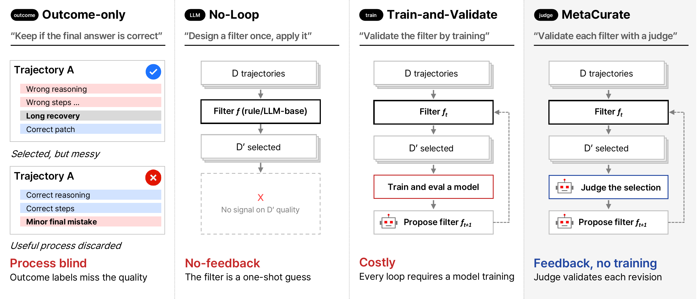

# MetaCurate: Evolving Curation Filters for High-Quality Agentic Coding Data

<p align="center">
  
</p>

<p align="center">
  Donghoon Kim<sup>*1</sup>, Seunghyuk Oh<sup>*1</sup>, Kevin Galim<sup>1</sup>, Minseo Kim<sup>2</sup>, Minjae Lee<sup>1</sup>,<br>
  Younghyun Kim<sup>1</sup>, Wooseok Seo<sup>1</sup>, Hyung Il Koo<sup>1</sup>, Wonjun Kang<sup>1</sup>
</p>
<p align="center">
  <sup>1</sup>FuriosaAI, <sup>2</sup>University of California, Berkeley<br>
  <sup>*</sup>Equal contribution
</p>

<p align="center">
  <a href="https://furiosa-air.github.io/metacurate/"></a>
  <!-- TODO: link the arXiv abstract and change the message to the arXiv ID once the preprint is out. -->
  
  <!-- TODO: link the Hugging Face dataset and change the message to "Hugging Face" once it is published. -->
  
</p>

MetaCurate evolves a curation filter for selecting SFT data from coding-agent
trajectories, using pairwise LLM judgments. A filter is a set of rules, an
LLM-scored rubric, and a policy that combines them into one score per
trajectory.

## Quick start

Requires Python 3.12 and [uv](https://docs.astral.sh/uv/).

```bash
uv sync
uv run python -m meta_filter.cli run --llm-provider mock \
    --selection-data data/demo_selection.jsonl
```

This runs three iterations offline with a mock LLM in a few seconds and ends
with `run complete: runs/<run_id>`. `runs/<run_id>/summary.csv` has one row
per iteration, and `runs/<run_id>/iterations/` holds every candidate filter.

## Repository layout

```
src/meta_filter/   the search loop
filters/           initial filters
configs/           the demo config and four example run configs
scripts/           selection-set, launcher and subset scripts
tests/             offline tests
```

## Running with real models

1. Put the trajectory pools under `data/` as JSONL, one trajectory per line
   (`trajectory_id`, `task`, `turns`, `metadata`; see
   `src/meta_filter/schemas.py`).
2. Judge the selection pairs once:
   ```bash
   uv run python -m scripts.build_selection_set --rows <selection.jsonl> \
       --judge-model <model> --judge-cache-dir data/pair_judge_cache \
       --out <selection_judged.json>
   ```
3. Run the search with one of the example configs:
   ```bash
   uv run python -m scripts.run_metadata_free --cell nemotron_blank
   ```
4. Score a pool with the final filter and keep the top rows with
   `scripts/build_ranking_subset.py` (`--help` lists its options).

`configs/metadata_free/README.md` lists the files each config expects.

> [!NOTE]
> Steps 2 to 4 need an LLM API key (see `.env.example`), and step 3 also needs
> the [Codex CLI](https://github.com/openai/codex). The quick start and the
> tests need neither.

## Tests

```bash
uv run pytest
```

## Citation

<!-- TODO: fill in the arXiv ID once the preprint is out. -->
```bibtex
@article{kim2026metacurate,
  title   = {MetaCurate: Evolving Curation Filters for High-Quality Agentic Coding Data},
  author  = {Kim, Donghoon and Oh, Seunghyuk and Galim, Kevin and Kim, Minseo and
             Lee, Minjae and Kim, Younghyun and Seo, Wooseok and Koo, Hyung Il and Kang, Wonjun},
  journal = {arXiv preprint arXiv:[ARXIV ID]},
  year    = {2026}
}
```

## License

[MIT](LICENSE)
